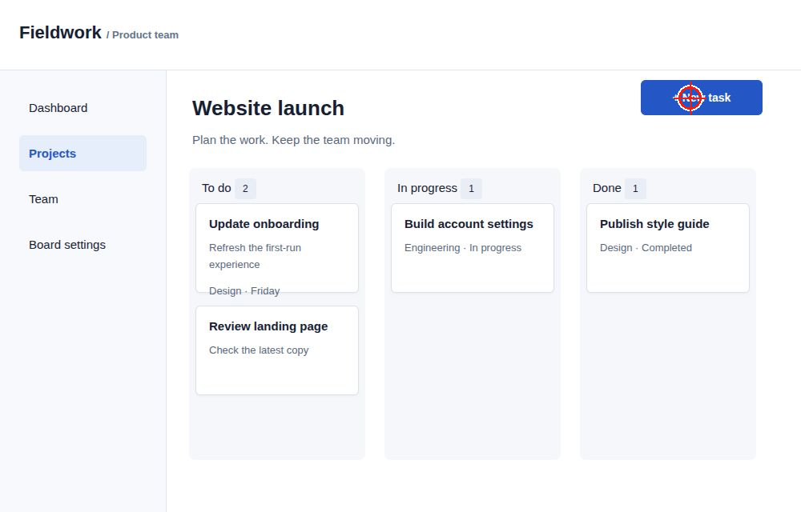
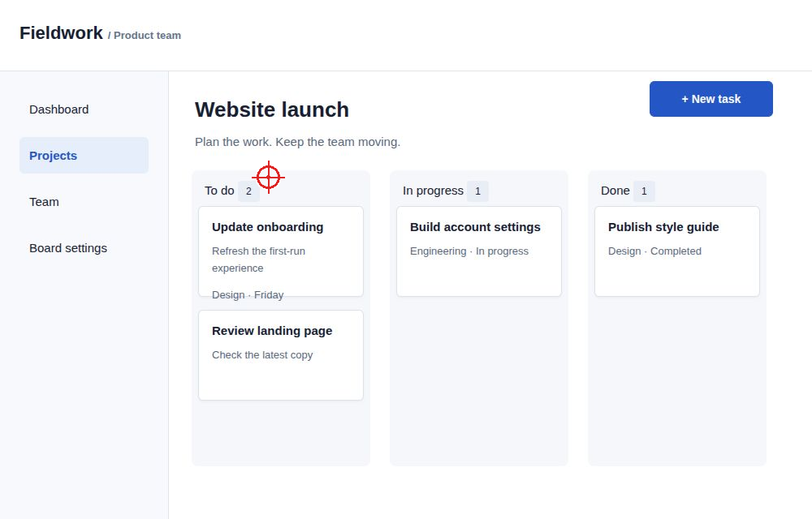

# ClickGuide

[](https://github.com/Rk1coder/clickguide/actions/workflows/test.yml)

**Find your next click. Inspect the model's suggestion.**

ClickGuide turns a screenshot and a short English instruction into an annotated
target location using a local vision-language model. It exposes the predicted
coordinates, a magnified crop, and an auditable JSON report. It does not click
buttons or control your computer.



## Run locally

Linux and Python 3.12 are the verified environment. The default installation uses
CPU PyTorch; no inference API key or paid service is required.

```bash
python3.12 -m venv .venv
source .venv/bin/activate
python -m pip install -r requirements.txt
python app.py
```

Open **http://127.0.0.1:7864**. Choose an original example or upload a screenshot,
describe one visible target in English, and select **Locate target**. Inspect the
red crosshair before acting. The first request downloads the model weights and
loads them into RAM. The recorded Qwen CPU run took 9–17 seconds per task; other hardware can differ. ShowUI took over a minute per task in the recorded run.

The application binds to loopback by default. `PORT`, `HOST`, `HF_HOME`,
`HF_HUB_CACHE`, and `CLICKGUIDE_THREADS` (1–16; default 4) can be configured.
`HF_HUB_OFFLINE=1` uses previously downloaded model files. Dependencies and model
files must already be installed/downloaded before fully offline use.

## How it works

1. Validate a PNG/JPEG and normalize its EXIF orientation and transparency.
2. Send only its pixels and the instruction to a pinned local model: Qwen3-VL by default, or ShowUI as a comparison.
3. Validate one point in the backend’s declared coordinate system, then normalize to `[0,1]`.
4. Convert to original normalized-image pixels, render a crosshair and crop, and
   export a report with the image checksum, model revision, timing and raw prediction.

Default model: `Qwen/Qwen3-VL-2B-Instruct` at revision `89644892e4d85e24eaac8bacfd4f463576704203`.
Set `CLICKGUIDE_MODEL=showui` to run `showlab/ShowUI-2B` at revision
`cabec4fcc48d15ffd3efe0b33ea9bc7d41509d60`. Qwen native integer coordinates use scale 1000; ShowUI uses fractional coordinates. The application uses
Transformers' built-in Qwen2-VL implementation with `trust_remote_code=False` and
weights-only checkpoint loading. Inference is serialized and the model loads lazily.

## Measured outputs

On the six original development tasks, Qwen3-VL hit **5/6** target regions and ShowUI hit **3/6**. Different backend preprocessing and CPU dtypes are documented; this is a comparison of configured pipelines, not a controlled model benchmark.

The repository includes six fixed tasks across three original fictional interfaces.
Every result, including missed targets, is retained in
[the ShowUI run](evaluation/local-cpu.json) and [the Qwen run](evaluation/qwen-cpu.json). Target regions are defined from
the fixture geometry before inference; they are never sent to the model.



The second image is a **miss**: the crosshair falls above the requested task card.
A valid coordinate is not proof that the model found the correct target. These
development fixtures do not establish general accuracy. See
[evaluation details](docs/EVALUATION.md) for the complete results and limitations.

## API

The local Gradio application exposes `/locate`:

```python
from gradio_client import Client, handle_file

client = Client("http://127.0.0.1:7864")
marked_image, detail, status, report, annotated_png = client.predict(
    handle_file("screenshot.png"),
    "Create a new task",
    api_name="/locate",
)
```

## Scope and limitations

- One non-animated PNG/JPEG: up to 10 MiB, 12 million pixels, and 4096 pixels per edge.
- English instructions of 3–300 characters; only the visible screenshot is available.
- Qwen receives at most 262,144 image pixels; ShowUI at most 401,408. Small labels
  and dense interfaces may lose detail.
- There is no reliable absent-target detection or confidence score. Ambiguous or
  nonexistent targets can still produce plausible coordinates.
- No browser state, DOM, accessibility tree, action history, or automatic clicking
  is used for inference. This is a single-step visual grounding tool.
- Original temporary reports expire after one hour and are capped at 32 directories.
  Gradio's additional upload/preview/download cache copies expire by age. Immutable
  public examples are exempt. Cleanup runs at startup, on new results, and every minute.
- Screenshot content stays on the machine running the app. Hugging Face is contacted
  for model downloads. If you expose the app to others, their files run on your server.
- The host must have sufficient RAM for a 2B model; latency and memory depend on hardware.

## Development

```bash
python -m pip install -r requirements-dev.txt
python -m pytest -q
ruff check .
ruff format --check .
python scripts/evaluate.py --model qwen --output evaluation/qwen-cpu.json
python scripts/evaluate.py --model showui --output evaluation/local-cpu.json
```

Automated tests use a deterministic inference fixture at the slow model boundary;
the separate measured runs perform real inference with both models. Tests cover image and
prediction validation, coordinate edges, non-destructive annotations, request
serialization, report isolation/expiration, and UI failure states.

## Project structure

```text
app.py                 Local workbench and Gradio API
clickguide/core.py     Image validation, coordinate parsing and annotations
clickguide/model.py    Pinned lazy ShowUI adapter
clickguide/service.py  Serialized processing, reports and cleanup
examples/             Original fictional interfaces, screenshots and target boxes
scripts/evaluate.py   Reproducible development evaluation
evaluation/           Recorded model outputs
docs/images/          Actual annotated outputs, including failures
tests/                Deterministic regression tests
```

See [the changelog](CHANGELOG.md) for development stages.

## License and references

Application code: [MIT](LICENSE). Original fictional fixtures: [CC0-1.0](examples/LICENSE).
Model weights have their own [ShowUI MIT license and model card](https://huggingface.co/showlab/ShowUI-2B).
Qwen weights use [Apache-2.0](https://huggingface.co/Qwen/Qwen3-VL-2B-Instruct).
This project uses pretrained models; it does not train or claim authorship of them.

- [ShowUI research and source](https://github.com/showlab/ShowUI)
- [ShowUI paper](https://arxiv.org/abs/2411.17465)
- [Official ShowUI Space](https://huggingface.co/spaces/showlab/ShowUI)
